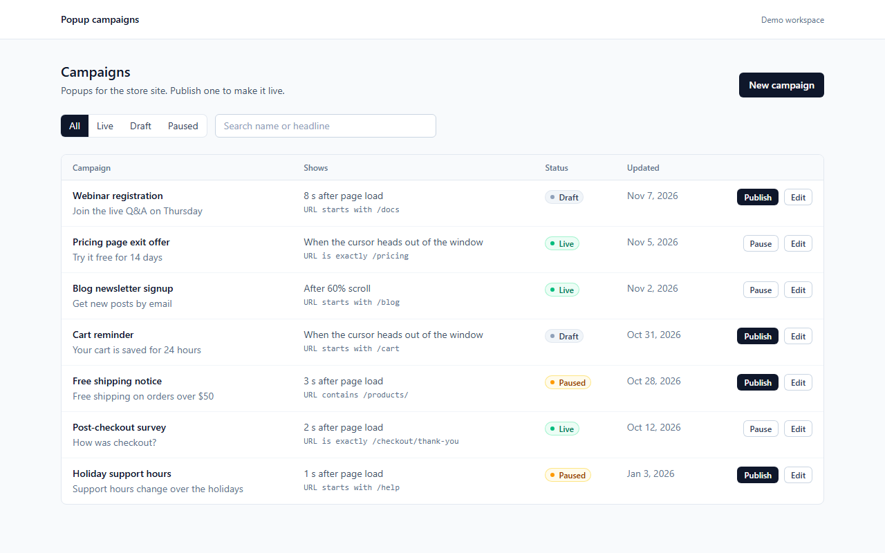
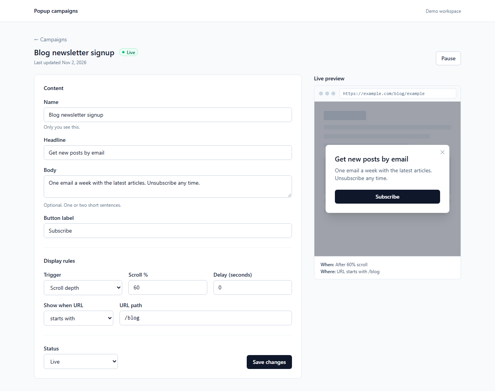

# graphql-dashboard

A small Next.js and GraphQL dashboard for managing popup campaigns, with typed operations and optimistic updates.

[](https://github.com/fatih255/graphql-dashboard/actions/workflows/ci.yml)



## Why this exists

At Popupsmart, customers designed and published their popups in a Next.js dashboard. I worked on it with React and Redux, connected the interfaces to GraphQL, and used Jest for unit tests and Cypress for end-to-end flows. I also took part in the move from the .NET backend to GraphQL, which is when I started working on both sides ([more on that here](https://fatihinci.com/experience/#dashboard)). This repo is a small from-scratch version of that pattern, not the production code.

## What it shows

- A GraphQL API with [graphql-yoga](https://the-guild.dev/graphql/yoga-server) running in a Next.js App Router route handler (`src/app/api/graphql/route.ts`).
- Typed errors as union results: `createCampaign` returns `Campaign | ValidationError`, publish and pause return `Campaign | NotFoundError | InvalidTransitionError`. Unexpected errors are masked.
- Input validation shared by the form and the resolvers (`src/shared/validation.ts`), so the form shows the same messages the server would send.
- GraphQL Code Generator for both sides: typed documents and operation types for the client, resolver signatures for the server. No `any`, and ESLint fails if one shows up.
- Redux Toolkit with RTK Query and a small GraphQL base query. Status filter and search live in a slice, so they survive navigation.
- Optimistic publish and pause: the badge changes right away and rolls back with an error toast if the server throws, returns a typed error, or answers with a 500.
- A create and edit form with a live preview of the popup, its trigger (on load, exit intent, scroll %), delay and URL rule.



## Run it

Tested with Node 24.

```bash
npm install
npm run dev
```

Open http://localhost:3101. Data is kept in `.data/campaigns.json`, which is created from the seed campaigns on first start. `npm run seed` resets it to the seed data (restart the dev server afterwards, it holds the data in memory).

Other scripts:

| Command | What it does |
| --- | --- |
| `npm run codegen` | Regenerates types from `src/server/typeDefs.ts` and `src/client/operations.ts` |
| `npm run lint` / `npm run typecheck` | ESLint and `tsc --noEmit` |
| `npm run screenshots` | Retakes the README screenshots with Playwright (needs `npm run build` first) |

## Tests

```bash
npm test                          # Vitest unit tests
npm run build && npm run test:e2e # Playwright end-to-end tests
```

The unit tests cover:

- validation rules for every field, including the scroll and URL rules
- resolvers, run through the real Yoga handler against an in-memory store: filtering, search, create, update, typed errors, status transitions and error masking
- the UI slice reducers
- the optimistic status change against the real handler: the cache flips while the mutation is in flight, then rolls back after a resolver error, an HTTP 500 or a typed error

The Playwright tests start `next start` on port 3102 with a fresh copy of the seed data. They create a campaign, edit it, publish it and check it appears under the Live filter. Two more tests force a failed publish and a failed pause by intercepting the GraphQL request, check the optimistic badge, then check it rolls back. CI runs all of it, plus lint, typecheck and a check that generated types match the schema.

## Limits

- No login or multiple workspaces. Everyone using the app shares one list.
- Storage is a JSON file loaded into memory, fine for one dev server and not meant for more.
- The preview shows the popup's content and rules. It doesn't run the trigger logic on a real page.
- No delete. Pause a campaign to take it down.

## License

MIT, see [LICENSE](LICENSE).
